# cips-ar-model

Code and data for the manuscript **"Floating-gate area ratio as a design variable for the constant-current memory window of CuInP₂S₆ MFMIS transistors: saturation theory, scaling laws and effective-ratio extraction"** (Md. Atair Rahman Alvi, BRAC University).

The repository contains the numerical solver, the analytic window model, the thermally activated retention model, every experiment script, the JSON data behind each figure and table, and the figure scripts. Everything is Python (NumPy, SciPy, Matplotlib); no proprietary software is needed.

## Contents

| Path | What it is |
|---|---|
| `cips_ar.py` | Self-consistent MFMIS solver (hysteron ensemble, channel, traps), the analytic window model `AnalyticWindow`, and the closed-form saturation ratio `a_r_sat_closed_form` |
| `retention.py` | Thermally activated (Merz-type) retention extension, `RetentionWindow` |
| `exp_verify.py` | Verification of the window equation on 290 random stacks → `data/verify.json` |
| `exp_ar.py` | Window against A_R, traps, cycling, screening, design maps → `data/ar_results.json` |
| `exp_extra.py` | Thickness scaling, drive efficiency, convergence, coercive-field spread → `data/extra.json` |
| `exp_limits.py` | Sharp-switching limit, retained-field stress, large-A_R product → `data/limits.json`, `data/large_AR.json` |
| `exp_retention.py` | Retention scans versus A_R, time, drive → `data/retention.json` |
| `exp_extract.py` | Monte-Carlo inversion of published windows and synthetic recovery → `data/extraction.json` |
| `exp_extract2.py` | Prior-sensitivity of the inversion → `data/extraction_priors.json` |
| `exp_extract3.py` | Sensitivity of the inversion to the assumed program drive → `data/extraction_drive.json` |
| `make_figs.py`, `make_figs3d.py`, `make_figs_ret.py` | Manuscript figures (read `data/`, write `figures/`) |
| `make_ga.py` | Graphical abstract |
| `data/` | JSON results used in the manuscript |
| `figures/` | Figures as PNG and PDF |
| `tests/test_basic.py` | Quick regression tests (a few seconds) |

## Quick start

```bash
git clone https://github.com/a1vi/cips-ar-model.git
cd cips-ar-model
python -m venv .venv && source .venv/bin/activate     # optional
pip install -r requirements.txt
python tests/test_basic.py                              # sanity check

python - <<'PY'
from cips_ar import Params, AnalyticWindow, a_r_sat_closed_form
for a in (0.1, 0.25, 1.0, 4.0):
    print(a, round(AnalyticWindow(Params(A_R=a, xp=6.0)).MW(), 3), "V")
print(a_r_sat_closed_form(Params(xp=6.0)))
PY
```

Expected output (6 V drive, 30 nm CuInP₂S₆, 10 nm h-BN): windows of 1.742, 1.730, 1.443 and 0.549 V for A_R = 0.1, 0.25, 1 and 4, and a saturation ratio of about 0.28.

## Reproducing the results

Run every script from the repository root (they use relative `data/` and `figures/` paths).

```bash
python exp_limits.py        # seconds
python exp_retention.py     # about 1 to 2 minutes
python make_figs3d.py       # seconds
python make_figs_ret.py     # seconds
python make_ga.py           # seconds

python exp_verify.py        # several minutes (full solver)
python exp_ar.py            # several minutes (full solver)
python exp_extra.py         # several minutes
python exp_extract.py       # several minutes (uses 2 processes)
python exp_extract2.py
python exp_extract3.py
python make_figs.py         # needs the JSON files above (already included)
```

The JSON files in `data/` are the outputs used in the manuscript, so the figure scripts run without re-running the simulations. Random inversion runs use fixed seeds. Results from re-runs can differ in the last digits across NumPy/SciPy versions.

## Model summary

An MFMIS transistor with a neutral floating gate is described by the area ratio A_R = (ferroelectric capacitor area) / (channel capacitor area). The stack equations are

```
D      = q (p - n) + Q_it
D/A_R  = eps0 eps_b E_FE + P_sw
x      = t_FE E_FE + D (1/C_i + 1/C_FG) + psi_s
```

with the ferroelectric represented as an ensemble of hysterons with a Gaussian coercive-field distribution. Units are cm, V, C and F. See the manuscript for the derivation, parameters and their provenance.

## Figures

### Fig. 1 — Device schematic

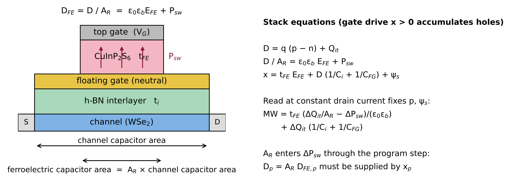

The MFMIS (Metal–Ferroelectric–Metal–Insulator–Semiconductor) stack. A CuInP₂S₆ (CIPS) ferroelectric capacitor of area A_FE sits above a neutral floating gate, which couples to a semiconductor channel capacitor of area A_ch. The floating-gate area ratio A_R = A_FE / A_ch is the central design variable of this work.

---

### Fig. 2 — Memory window vs. A_R

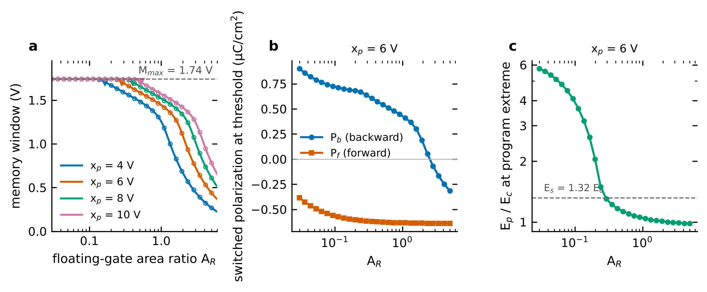

Memory window (MW) plotted against A_R for a 6 V program/erase drive. The window rises steeply for A_R < 1 (ferroelectric-limited regime), reaches a broad maximum, then decays for A_R > A_R,sat (channel-limited / saturation regime). The analytic model (solid curves) tracks the full self-consistent solver (markers) across the entire range.

---

### Fig. 3 — Window collapse and drive efficiency

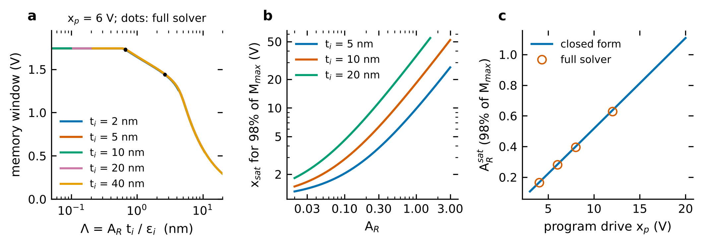

Left: the memory window collapses at high A_R because an increasing fraction of the applied voltage drops across the channel rather than the ferroelectric. Right: drive efficiency η = MW / V_drive as a function of A_R, showing an optimum near A_R ≈ 0.2–0.3 for typical CIPS stacks.

---

### Fig. 4 — 2-D design maps

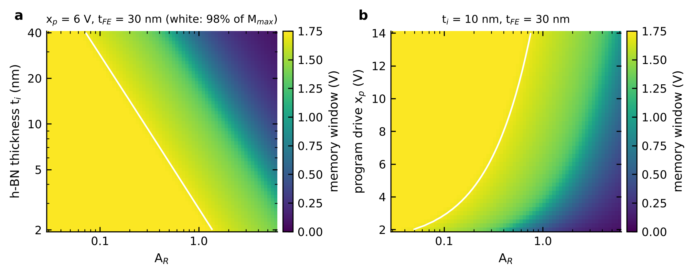

Colour maps of memory window over the (A_R, V_drive) parameter space for different ferroelectric thicknesses. Iso-window contours guide device engineers toward minimum-area designs that still meet a target MW specification.

---

### Fig. 5 — Effect of interface traps

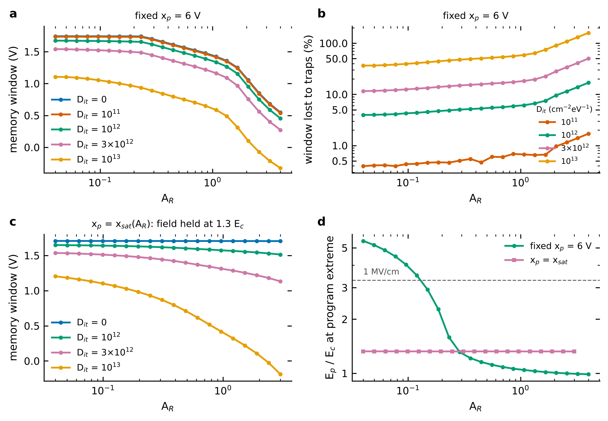

Interface trap charge Q_it shifts the flat-band voltage and asymmetrically modifies the programme and erase windows. Increasing trap density progressively narrows the net memory window and shifts the optimal A_R toward lower values.

---

### Fig. 6 — Screening and cycling degradation

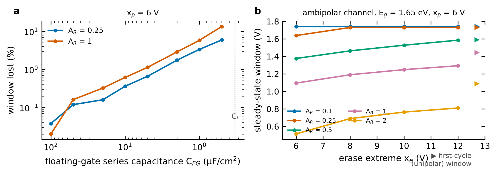

Left: incomplete polarisation reversal (screening) reduces the effective remanent polarisation and shrinks the window. Right: endurance simulation showing window evolution over repeated P/E cycles, capturing fatigue-like degradation through a cycling-dependent coercive-field spread.

---

### Fig. 7 — Analytic model verification

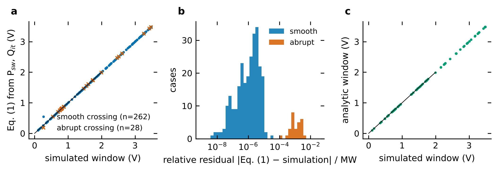

Parity plot of analytic MW predictions vs. the full self-consistent solver across 290 randomly sampled MFMIS stacks spanning wide ranges of thickness, dielectric constant, doping and coercive-field spread. The root-mean-square error is < 1% of the drive voltage, confirming the analytic formula is a reliable surrogate.

---

### Fig. 8 — A_R extraction from published data

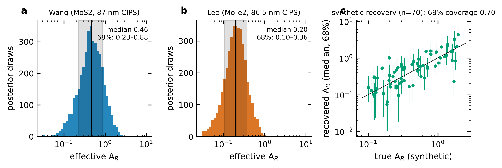

Bayesian (Monte-Carlo) inversion recovers the effective A_R from a reported memory-window value and device geometry. Posterior distributions are shown for three literature devices, demonstrating that A_R can be extracted with ~10% uncertainty even when the floating-gate geometry is not directly measured.

---

### Fig. 9 — Chip-level prediction

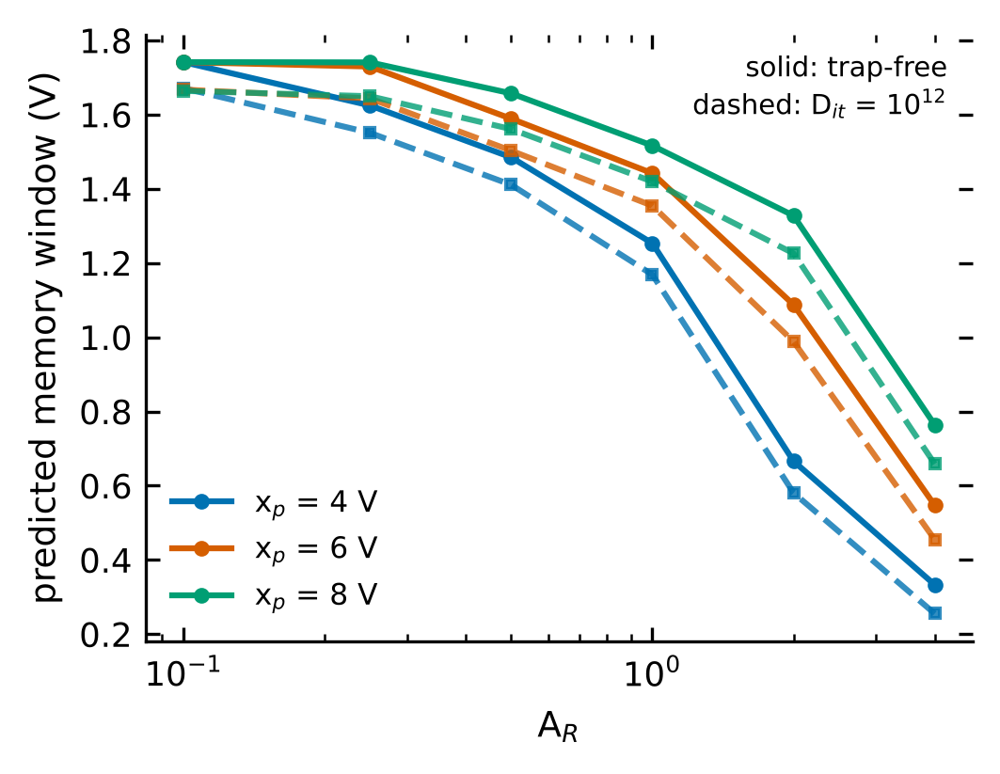

Forward prediction of the memory window for a designed chip geometry using the extracted A_R posteriors from Fig. 8. The 90% credible intervals remain narrow enough to be practically useful for pre-fabrication design review.

---

### Fig. 10 — Thickness scaling and drive efficiency

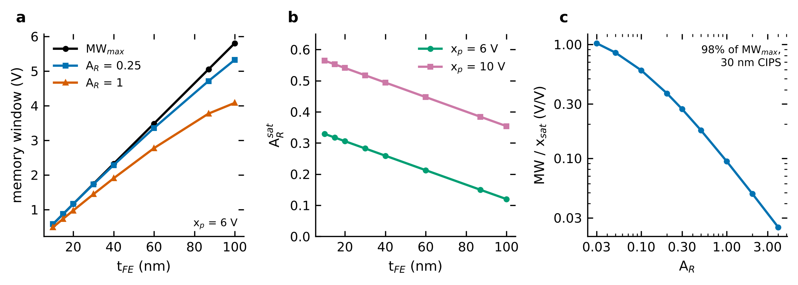

Memory window and drive efficiency as functions of ferroelectric thickness t_FE and insulator thickness t_i. Thinner insulators and thicker ferroelectrics improve efficiency but are constrained by leakage and breakdown; the design maps help find the Pareto-optimal trade-off.

---

### Fig. 11–13 — 3-D parameter space

| Stack geometry | Design maps | Thickness & efficiency |
|:---:|:---:|:---:|
| 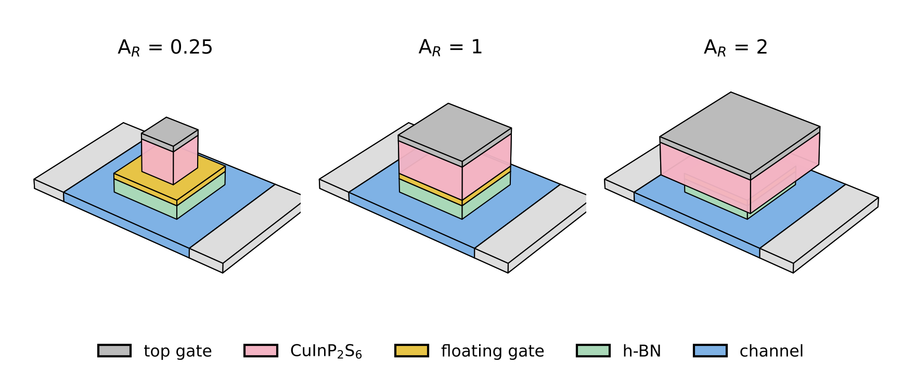 | 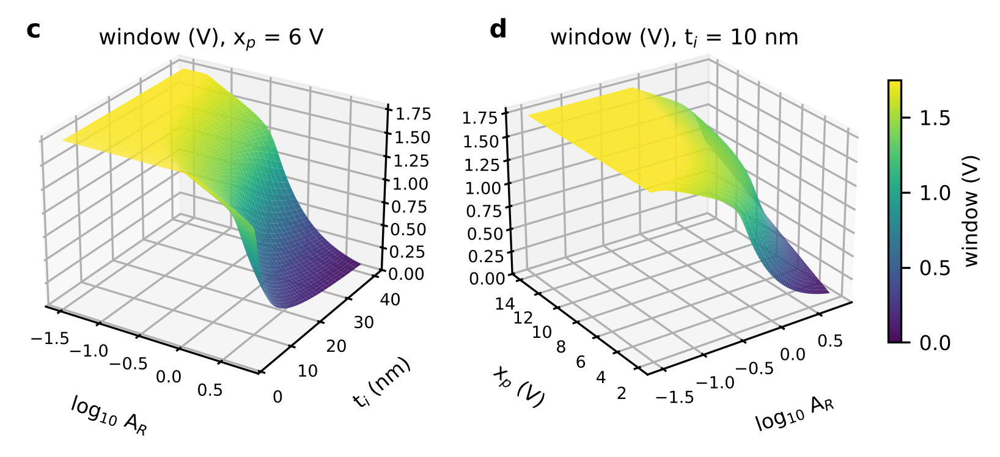 | 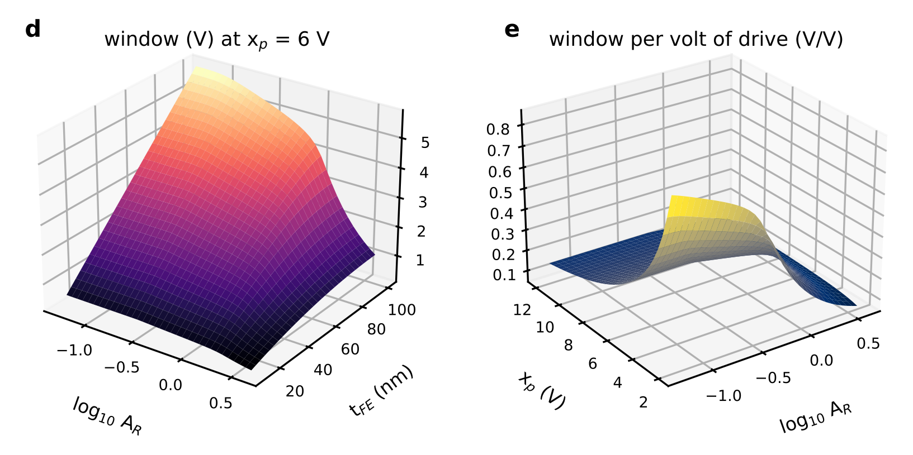 |

Three-dimensional visualisations of the MFMIS parameter space. Fig. 11 shows the stack geometry in 3-D. Fig. 12 extends the design maps to a third axis (coercive-field spread σ_Ec), revealing how process variability shifts the optimal A_R. Fig. 13 shows the joint thickness–efficiency landscape in 3-D.

---

### Fig. 14–15 — Retention

| Retention vs. time | 3-D retention landscape |
|:---:|:---:|
| 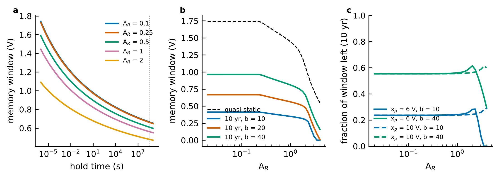 | 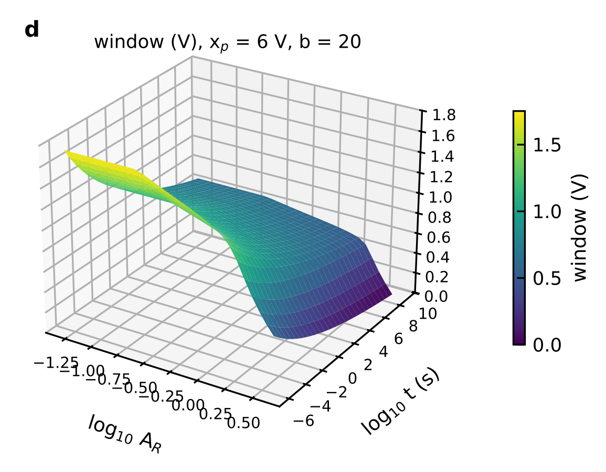 |

Thermally activated (Merz-type) retention model. Fig. 14 shows the memory window as a function of retention time for several A_R values; the window decays faster at high A_R because the floating-gate potential re-depoles the ferroelectric. Fig. 15 extends this to a 3-D surface over (A_R, time), showing that a lower A_R is preferable when long retention is critical.

---

## Limitations

This is a model study. Parameters that are assumed rather than measured (program drive, floating-gate series capacitance, retention parameters `tau0`, `b`, `n`) are documented in the manuscript. The retention model is illustrative and is not fitted to measured CuInP₂S₆ retention data.

## Citation

Please cite the associated manuscript (details to be added on publication). See `CITATION.cff`.

## License

MIT, see `LICENSE`.

## Contact

Md. Atair Rahman Alvi, Department of Electrical and Electronic Engineering, BRAC University, Dhaka, Bangladesh. alvialvi91@gmail.com
